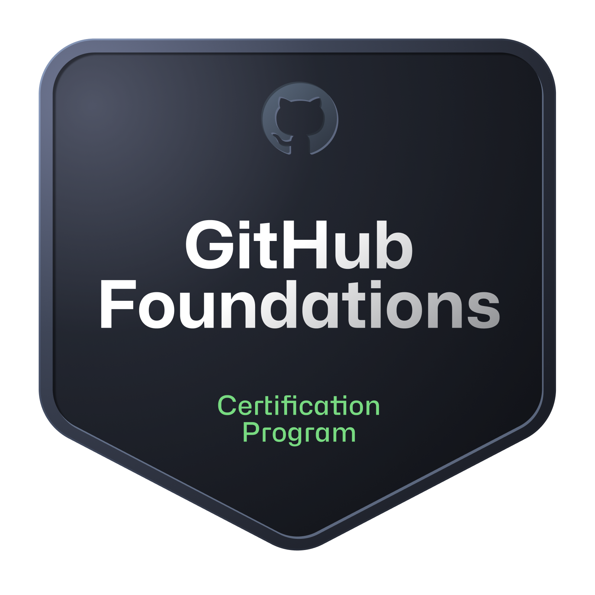
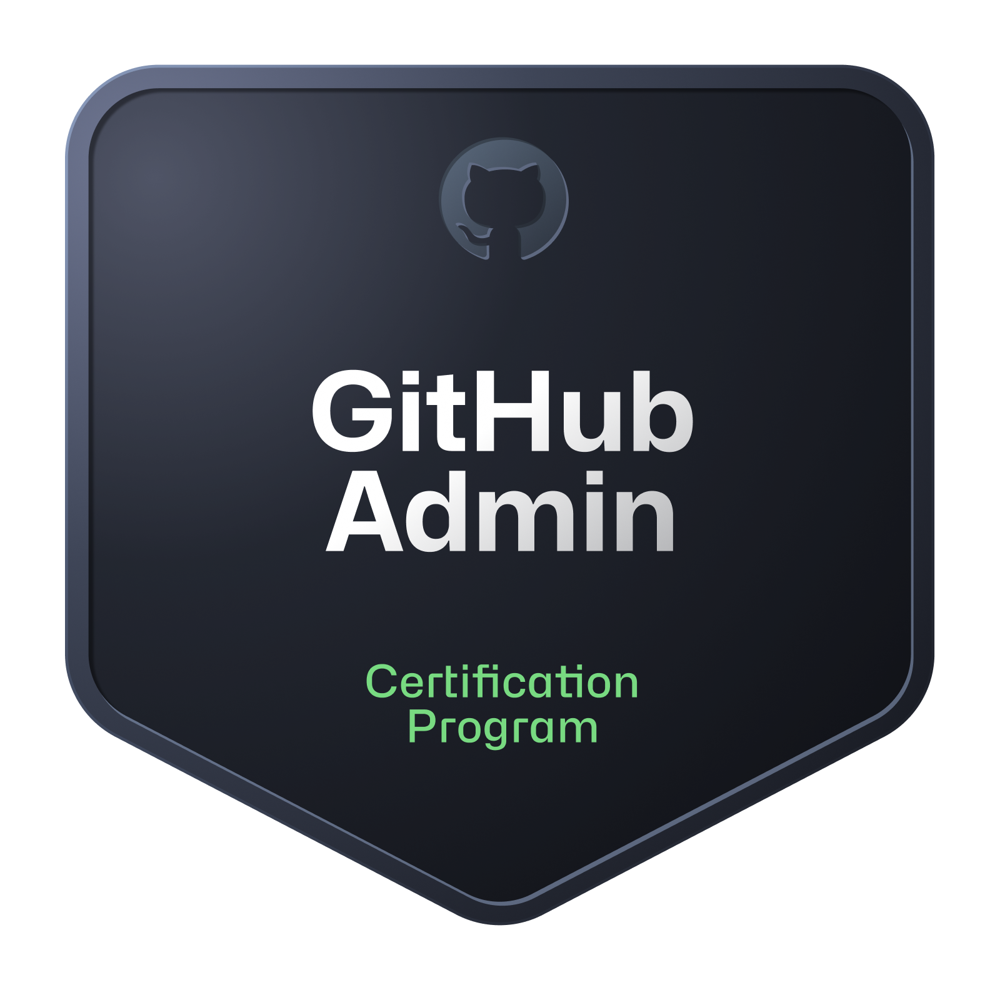
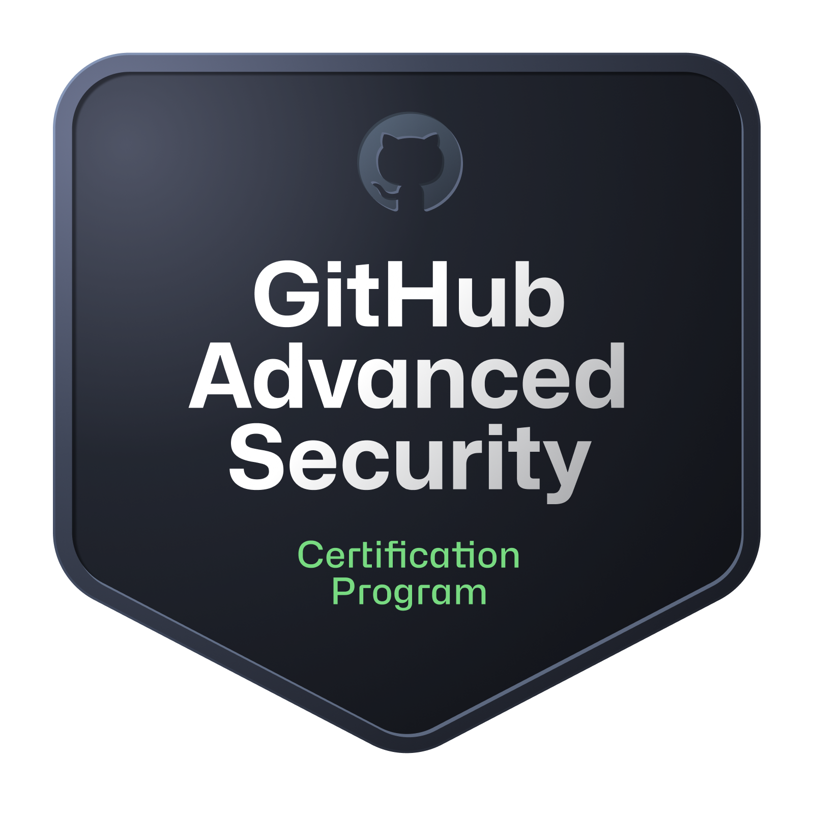
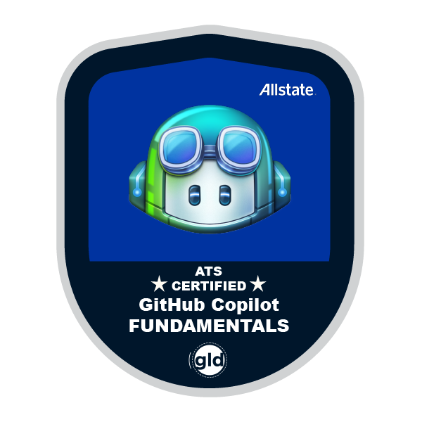
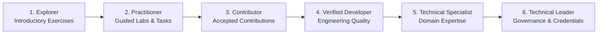

# COSL Learning, Credentials & Certification Policy

**Organization:** Codemo Open Source Labs (COSL)  
**Parent Organization:** Codemo Teams  
**Policy Owner:** COSL Leadership  
**Scope:** Leadership, maintainers, contributors, learners, and participants  
**Review:** At least annually  

> [!IMPORTANT]
> **Policy Status:** This document outlines a proposed organizational policy for Codemo Open Source Labs. It becomes formally binding only after COSL leadership formally adopts it. Requirements are not described or enforced as binding prior to that decision.

---

## 1. Purpose

COSL develops future technical leaders through structured learning, practical engineering, open-source collaboration, and professional development.

This policy establishes two distinct pathways:
- **Leadership qualification:** Designated senior leadership roles must earn relevant GitHub certifications through official examinations.
- **Open learning:** Learners and ordinary contributors can develop their skills through self-directed learning, practical labs, and contributions without mandatory paid examinations.

Course completion and professional certification are separate achievements.

COSL's official leadership positions and authority boundaries are defined in [ORGANIZATION.md](ORGANIZATION.md). Certification requirements are determined by actual organizational responsibility and delegated authority, not by title alone.

---

## 2. Official Learning Resources

COSL recommends:
- [GitHub Skills](https://learn.github.com/skills): Practical GitHub exercises.
- [GitHub Credentials](https://learn.github.com/credentials): Official certification catalogue.
- [GitHub Courses](https://learn.github.com/courses): Structured learning modules.
- [Microsoft Learn](https://learn.microsoft.com/training/): Technical education and examination preparation.

COSL may develop its own learning paths and connect them to practical labs and projects.

---

## 3. Mandatory Certification for Senior Leadership

### 3.1 GitHub Foundations

  

The following positions must earn **[GitHub Foundations](https://learn.github.com/credentials)** by passing the official certification examination, subject to formal adoption of this policy:
- COSL Director and Deputy Director.
- GitHub Organization Owners.
- Organization administrators who exercise COSL-wide authority.
- Other individuals explicitly designated as holding top-level organizational governance or administrative authority.

A Functional Lead, Project Maintainer, Mentor or Contributor is not automatically covered solely because of their position title. The requirement depends on their actual organizational authority.

### 3.2 Optional Role-Specific Certifications

The following certifications may be recommended when COSL establishes a corresponding specialist responsibility or assigns that work to an existing Functional Lead. These are not additional mandatory COSL leadership positions. They do not create new departments or appointment requirements:

| Badge | Relevant Responsibility | Certification Area | Action |
|:---:|:---|:---|:---:|
|  | GitHub organization administration | [GitHub Administration](https://learn.github.com/credentials) | [View Catalogue](https://learn.github.com/credentials) |
|  | Security responsibilities | [GitHub Advanced Security](https://learn.github.com/credentials) | [View Catalogue](https://learn.github.com/credentials) |
|  | CI/CD and release engineering | [GitHub Actions](https://learn.github.com/credentials) | [View Catalogue](https://learn.github.com/credentials) |
|  | AI-assisted development | [GitHub Copilot](https://learn.github.com/credentials) | [View Catalogue](https://learn.github.com/credentials) |
| None | Agent engineering | [GitHub Agentic AI Developer](https://learn.github.com/credentials) | [View Catalogue](https://learn.github.com/credentials) |

The exact certification names and availability must continue to be checked against the official credential catalogue.

### 3.3 Existing and New Leadership
- **New appointments** to covered positions must satisfy the GitHub Foundations requirement before receiving permanent organization-wide authority.
- **Existing leadership** receives a six-month transition period after formal adoption of this policy.
- **Temporary exceptions** may be approved for documented examination availability, accessibility, scheduling, or financial barriers.
  - Exceptions must have a defined completion plan.
  - An exception must never be represented as a passed certification.

### 3.4 Competence Beyond Certification
Certification alone does not establish leadership competence. Leadership appointments must also consider:
- Practical technical ability.
- Project and contribution history.
- Security awareness.
- Engineering judgment.
- Reliability and accountability.
- Mentorship and communication.
- Community responsibility.

---

## 4. Contributors and Learners

Ordinary contributors, developers, students, and learners are **not** required to purchase or pass professional certification examinations.

They are encouraged to:
- Complete GitHub Skills exercises.
- Study official learning paths.
- Complete COSL labs.
- Participate in practical projects.
- Submit pull requests.
- Review code.
- Improve documentation and testing.
- Contribute to established upstream open-source projects.

Project maintainers may define relevant technical onboarding requirements for individual projects. These must not be misrepresented as a COSL-wide paid certification requirement.

---

## 5. Achievement Categories

COSL recognizes four achievement categories:

| Category | Evidence |
|:---|:---|
| **Learning Achievement** | Completed exercises, courses, and learning paths |
| **Technical Achievement** | Reviewed labs, project deliverables, tests, and demonstrations |
| **Open-Source Achievement** | Accepted pull requests, reviews, maintenance, and upstream contributions |
| **Professional Certification** | Official examination-based credentials with verifiable evidence |

Achievements may support mentorship, recognition, project responsibilities, and progression within the Codemo Teams ecosystem. Quality and impact are more important than raw activity counts.

---

## 6. Credential Verification and Privacy

- Professional certifications must be verified through an issuer-supported credential link or another accepted verification method.
- COSL should record only necessary information: credential name, issuer, verification status, verification URL, and relevant dates.
- Passwords, examination account access, and unnecessary identity documents must **never** be requested.
- Screenshots alone should not replace official verification where an issuer-supported link exists.
- Personal credentials must not be published without the individual's consent.
- Credential records must be access-controlled and retained only for a legitimate organizational purpose.

---

## 7. Examination Funding

COSL should prioritize examination funding for mandatory leadership certifications when its budget permits.

Funding rules should:
- Be published before examination booking.
- Define eligibility and reimbursement conditions.
- Avoid guaranteeing discounts or vouchers that have not been verified.
- Encourage eligible students to check current official student benefits.
- Preserve free self-learning opportunities for participants who cannot afford examinations.

Current examination fees, regional pricing, delivery methods, and retake policies must be checked through official sources.

---

## 8. COSL Progression Pathway

COSL may recognize contributor development through the following progression:
1. **Explorer**: Begins learning and completes introductory exercises.
2. **Practitioner**: Demonstrates skills through labs and guided tasks.
3. **Contributor**: Makes accepted contributions.
4. **Verified Developer**: Demonstrates consistent engineering quality and responsible collaboration.
5. **Technical Specialist**: Demonstrates expertise in a technical domain.
6. **Technical Leader**: Demonstrates technical judgment, mentorship, delivery, governance responsibility, and required role-based credentials.

Progression is evidence-based and subject to authorized review. Course completion or activity volume alone does not guarantee promotion.

The COSL progression pathway recognizes learning and technical development. It is not an organizational hierarchy. Reaching Technical Leader or another progression stage does not automatically appoint a participant to a COSL leadership position, grant repository permissions or provide organizational authority. Formal leadership appointments follow [ORGANIZATION.md](ORGANIZATION.md) and applicable COSL governance.

---

## 9. Responsibilities

Official leadership responsibilities, reporting relationships, and authority boundaries are defined authoritatively in [ORGANIZATION.md](ORGANIZATION.md). Within this credentialing and learning framework:

- **COSL Leadership:**
  - Maintain this policy.
  - Define leadership certification requirements.
  - Approve exceptions.
  - Oversee funding and compliance.
- **Senior Role Holders:**
  - Obtain required certifications.
  - Maintain credentials where renewal is applicable.
  - Provide verification when requested.
- **Project Maintainers:**
  - Define practical technical expectations.
  - Support contributors and learners.
  - Evaluate contributions fairly.
- **Mentors:**
  - Guide participants toward suitable learning resources.
  - Connect theoretical learning to practical engineering.
- **Participants:**
  - Represent qualifications honestly.
  - Respect credential verification and privacy requirements.
  - Follow COSL governance and community standards.

---

## 10. Official-Source Precedence

Official GitHub credential documentation and the relevant examination provider determine current certification names, examination objectives, fees, availability, validity, and delivery requirements. This policy does not guarantee that a certification will remain available or retain its current price.

- [GitHub Credentials](https://learn.github.com/credentials)
- [GitHub Skills](https://learn.github.com/skills)
- [GitHub Courses](https://learn.github.com/courses)
- [Microsoft Learn Credentials](https://learn.microsoft.com/credentials/)

---

  <strong>COSL × Codemo Teams</strong> &bull; Building Future Technical Leaders.

