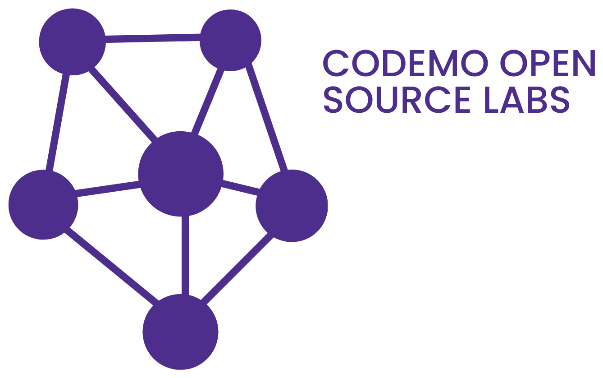

<p align="center">
  
</p>

<h1 align="center">COSL Organization Meta-Repository</h1>

<p align="center">
  <em>Default community health files, global standards, and public organization profile for <a href="https://github.com/codemolabs">@codemolabs</a>.</em>
</p>

<p align="center">
  <a href="https://discord.gg/wD9d5Er7a"></a>
  <a href="https://cosl.codemoteams.org"></a>
  <a href="https://codemoteams.org"></a>
  <a href="https://github.com/codemolabs"></a>
  <a href="LICENSE"></a>
</p>

---

## Overview

This repository (`codemolabs/.github`) is a special GitHub meta-repository. It provides two foundational functions for the **Codemo Open Source Labs (COSL)** ecosystem:

1. **Public Organization Profile (`profile/README.md`):** Renders the front-page view and orientation at [`https://github.com/codemolabs`](https://github.com/codemolabs).
2. **Organization-Wide Community Health Defaults:** Provides fallback governance, contribution guidelines, issue forms, and security policies that cascade to all repositories under the `codemolabs` organization.

---

## Architecture & Directory Layout

```
.github/
├── profile/
│   └── README.md                      # Public profile rendered at github.com/codemolabs
├── .github/
│   ├── ISSUE_TEMPLATE/
│   │   ├── bug_report.yml             # Structured issue form for bug reports
│   │   ├── feature_request.yml        # Structured issue form for proposals & labs
│   │   └── config.yml                 # Guidance directing questions to Discord
│   └── pull_request_template.md       # Standard PR template with verification checklist
├── media/
│   ├── README.md                      # Brand assets index & usage guidelines
│   ├── cosl-banner.png                # Horizontal banner logo (1338 × 838)
│   ├── cosl-logo.png                  # Square logo mark (1563 × 1563)
│   ├── credentials/                   # Official GitHub certification badges
│   └── icons/                         # High-DPI Iconify SVG vector icons
├── CODE_OF_CONDUCT.md                 # Contributor Covenant v2.1 code of conduct
├── CONTRIBUTING.md                    # Universal contribution guidelines & expectations
├── CREDENTIALS.md                     # Learning, credentialing, & leadership standards
├── ORGANIZATION.md                    # COSL hierarchy and role responsibilities
├── SECURITY.md                        # Coordinated vulnerability disclosure policy
├── SUPPORT.md                         # Support channels, community help, and contacts
├── RULES.md                           # Extended community rules & behavioral bounds
├── LEGALIZATION.md                    # Legal, copyright, trademark, and warranty notes
└── LICENSE                            # MIT License for this meta-repository
```

---

## How Community Health Files Cascade

GitHub automatically inherits files from this repository for any project in `codemolabs` that does not define its own:

| File / Folder | GitHub Feature | Inherited Scope |
|:---|:---|:---|
| `profile/README.md` | Public Organization Profile | Rendered on [`github.com/codemolabs`](https://github.com/codemolabs) |
| `media/` | Brand Assets Directory | Standard logos & banners for org projects |
| `ORGANIZATION.md` | Hierarchy & Governance | Defines roles, authority limits, and reporting |
| `CODE_OF_CONDUCT.md` | Community Health Check | Active across all member repositories |
| `CONTRIBUTING.md` | PR / Issue Contributor Guidance | Displayed to contributors opening PRs |
| `CREDENTIALS.md` | Policy & Advancement Guide | Universal reference for learning & certifications |
| `SECURITY.md` | Security Advisory Tab | Powers the Security tab across all org repos |
| `SUPPORT.md` | Help & Community Links | Displayed under repository support menus |
| `ISSUE_TEMPLATE/` | GitHub Issue Forms | Standardizes bug reports and lab proposals |
| `pull_request_template.md` | Pull Request Template | Pre-populates the PR submission form |

> [!NOTE]
> Individual repositories may override any of these files by providing a project-specific version in their own root or `.github/` directory.

---

## Contact & Maintainers

- **Website:** [codemoteams.org](https://codemoteams.org)
- **Discord Community:** [discord.gg/wD9d5Er7a](https://discord.gg/wD9d5Er7a)
- **General & Security Contact:** [cosl@codemoteams.org](mailto:cosl@codemoteams.org)
