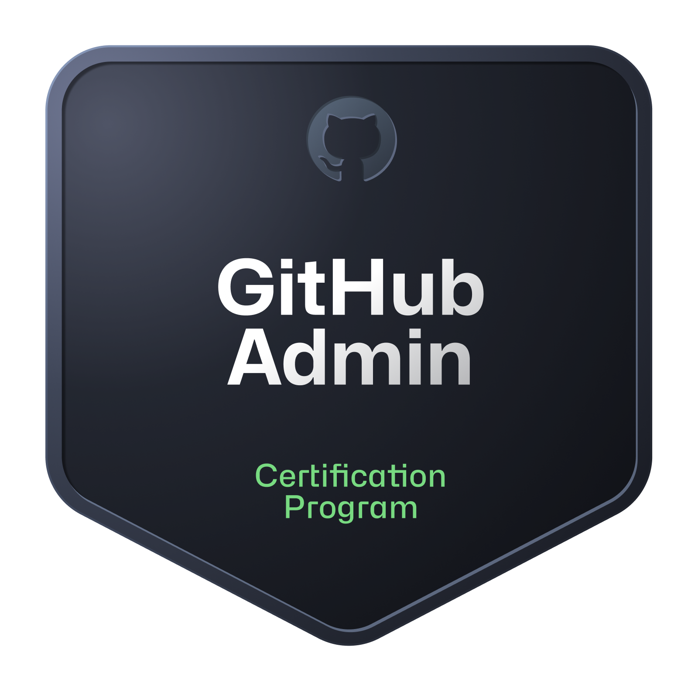

  

<h1 align="center">Open source is learned by doing.</h1>

  <em>Free labs. Real projects. A community to build with.</em>

  
  &nbsp;
  
  &nbsp;
  
  &nbsp;
  

  

---

### About COSL

Open source can often feel intimidating to enter. **Codemo Open Source Labs (COSL)** bridges the gap between learning technology and building with it. We create free, hands-on environments where developers, students, and enthusiasts move from reading theory to shipping real code—collaboratively in the open.

 

<table>
  <tr>
    <td align="center" width="33%" valign="top">
       
      <a href="https://github.com/orgs/codemolabs/repositories">
        
          
        <strong>1. Learn</strong>
      </a>
        
      Hands-on guided labs, exercises, and structured study
        
    </td>
    <td align="center" width="33%" valign="top">
       
      <a href="https://github.com/orgs/codemolabs/repositories">
        
          
        <strong>2. Build</strong>
      </a>
        
      Real-world software tools, media apps, and automation
        
    </td>
    <td align="center" width="33%" valign="top">
       
      <a href="https://discord.gg/wD9d5Er7a">
        
          
        <strong>3. Share</strong>
      </a>
        
      Collaborate, review in the open, and contribute back
        
    </td>
  </tr>
</table>

---

### Technical Focus Areas

Our initiatives span real-world software, infrastructure tools, and interactive labs:

<table>
  <tr>
    <td width="50%" valign="top">
      <h4>
        <a href="https://github.com/orgs/codemolabs/repositories">
          
          &nbsp;&nbsp;Systems &amp; Security Automation
        </a>
      </h4>
      
Practical security tooling, automated hardening, Linux configurations, and zero-trust engineering labs designed for safe, hands-on learning.

      
<a href="https://github.com/orgs/codemolabs/repositories"><strong>Explore Security Projects &rarr;</strong></a>

    </td>
    <td width="50%" valign="top">
      <h4>
        <a href="https://github.com/codemoteams/Brave-Music">
          
          &nbsp;&nbsp;Modern Applications &amp; Media
        </a>
      </h4>
      
Performance-focused client and web applications—such as <a href="https://github.com/codemoteams/Brave-Music"><strong>Brave-Music</strong></a>—built with clean architecture and responsive user experiences.

      
<a href="https://github.com/codemoteams/Brave-Music"><strong>Explore Brave-Music &rarr;</strong></a>

    </td>
  </tr>
  <tr>
    <td width="50%" valign="top">
      <h4>
        <a href="https://github.com/orgs/codemolabs/repositories">
          
          &nbsp;&nbsp;Developer Tooling &amp; DevOps
        </a>
      </h4>
      
Productivity scripts, CI/CD workflows, and cross-platform utilities that make open-source development faster and more reliable.

      
<a href="https://github.com/orgs/codemolabs/repositories"><strong>Explore Developer Tools &rarr;</strong></a>

    </td>
    <td width="50%" valign="top">
      <h4>
        <a href="https://github.com/orgs/codemolabs/repositories">
          
          &nbsp;&nbsp;Open Educational Labs
        </a>
      </h4>
      
Curated, beginner-to-advanced technical challenges that walk learners through git workflows, code reviews, and software testing.

      
<a href="https://github.com/orgs/codemolabs/repositories"><strong>Start Educational Labs &rarr;</strong></a>

    </td>
  </tr>
</table>

---

### How to Contribute

We welcome contributions of all sizes—documentation improvements, bug fixes, automated tests, lab concepts, and new features.

 

<table>
  <tr>
    <td align="center" width="25%" valign="top">
       
      <a href="https://github.com/orgs/codemolabs/repositories">
        
          
        <strong>1. Explore</strong>
      </a>
        
      Find open projects &amp; beginner issues
        
    </td>
    <td align="center" width="25%" valign="top">
       
      <a href="https://github.com/codemolabs/.github/blob/main/CONTRIBUTING.md#a-good-contribution-flow">
        
          
        <strong>2. Fork &amp; Branch</strong>
      </a>
        
      Create a focused, clean feature branch
        
    </td>
    <td align="center" width="25%" valign="top">
       
      <a href="https://github.com/codemolabs/.github/blob/main/CONTRIBUTING.md#pull-request-checklist">
        
          
        <strong>3. Test &amp; Verify</strong>
      </a>
        
      Verify changes locally and review code
        
    </td>
    <td align="center" width="25%" valign="top">
       
      <a href="https://github.com/codemolabs/.github/blob/main/CONTRIBUTING.md#review-and-merge">
        
          
        <strong>4. Submit PR</strong>
      </a>
        
      Open a PR using our standard checklist
        
    </td>
  </tr>
</table>

#### Contribution Principles

- **Focus &amp; Clarity:** Keep pull requests targeted to solve one clear objective.
- **AI-Assisted Contributions:** AI tools are welcome. However, human contributors must review, understand, test, and take complete responsibility for every line submitted.
- **Safety First:** We maintain zero tolerance for malicious code, credential scrapers, or unauthorized security exploits.
- **Kindness &amp; Mentorship:** Every question is valid. We prioritize constructive feedback and progress over perfection.

Read our complete [**Contributing Guide**](https://github.com/codemolabs/.github/blob/main/CONTRIBUTING.md) for step-by-step instructions and pull request checklists.

---

### Community & Governance Standards

All projects across the COSL ecosystem follow shared community health standards:

| Document | Focus &amp; Scope | Action |
|:---|:---|:---:|
| <a href="https://github.com/codemolabs/.github/blob/main/ORGANIZATION.md">&nbsp;&nbsp;**Organization Structure**</a> | COSL hierarchy, leadership responsibilities, and authority boundaries | [**View Structure**](https://github.com/codemolabs/.github/blob/main/ORGANIZATION.md) |
| <a href="https://github.com/codemolabs/.github/blob/main/CONTRIBUTING.md">&nbsp;&nbsp;**Contributing Guide**</a> | Step-by-step contribution flow, commit standards, and PR checklist | [**Read Guide**](https://github.com/codemolabs/.github/blob/main/CONTRIBUTING.md) |
| <a href="https://github.com/codemolabs/.github/blob/main/CODE_OF_CONDUCT.md">&nbsp;&nbsp;**Code of Conduct**</a> | Expected behavior, inclusive environment pledge, and moderation principles | [**Read Policy**](https://github.com/codemolabs/.github/blob/main/CODE_OF_CONDUCT.md) |
| <a href="https://github.com/codemolabs/.github/blob/main/SECURITY.md">&nbsp;&nbsp;**Security Policy**</a> | Responsible vulnerability reporting instructions and safe harbor terms | [**Read Policy**](https://github.com/codemolabs/.github/blob/main/SECURITY.md) |
| <a href="https://github.com/codemolabs/.github/blob/main/SUPPORT.md">&nbsp;&nbsp;**Support &amp; Help**</a> | How to ask questions, join Discord channels, and connect with maintainers | [**Get Help**](https://github.com/codemolabs/.github/blob/main/SUPPORT.md) |
| <a href="https://github.com/codemolabs/.github/blob/main/CREDENTIALS.md">&nbsp;&nbsp;**Learning &amp; Credentials**</a> | Official learning paths, leadership certifications, and progression tiers | [**Read Policy**](https://github.com/codemolabs/.github/blob/main/CREDENTIALS.md) |
| <a href="https://github.com/codemolabs/.github/blob/main/RULES.md">&nbsp;&nbsp;**Community Rules &amp; Legal Notes**</a> | Extended behavioral guidelines, licensing, trademark, and usage notices | [**Read Rules**](https://github.com/codemolabs/.github/blob/main/RULES.md) |

---

### Learning, Certifications & Achievements

COSL supports continuous learning through practical exercises, structured study, open-source contributions, and independently verifiable professional credentials.

#### Official GitHub Learning Platforms
- [**GitHub Skills**](https://learn.github.com/skills) — Hands-on interactive GitHub exercises.
- [**GitHub Credentials**](https://learn.github.com/credentials) — Official certification catalogue and proctored examinations.
- [**GitHub Courses**](https://learn.github.com/courses) — Structured technical learning modules.
- [**Microsoft Learn**](https://learn.microsoft.com/training/) — Technical education and exam preparation.

#### Leadership Certification Framework

COSL's proposed leadership certification framework requires designated senior leadership and organization-level authority holders to earn GitHub Foundations through the official certification examination. This requirement becomes binding only after formal COSL adoption. Other technical certifications may be recommended according to assigned responsibilities and actual technical requirements:

| Certification | Examination &amp; Credentials | Target Leadership Area | Official Exam |
|:---:|:---|:---|:---:|
|  | [**GitHub Foundations**](https://learn.github.com/credentials) Repository management, Git collaboration, project workflows, and features. | **Mandatory** for COSL Director, Deputy Director, Organization Owners, and Administrators with COSL-wide authority | [**Learn More**](https://learn.github.com/credentials) |
|  | [**GitHub Advanced Security**](https://learn.github.com/credentials) Code scanning, secret scanning, dependency review, and vulnerability remediation. | Optional specialist certification (Security) | [**Learn More**](https://learn.github.com/credentials) |
|  | [**GitHub Actions**](https://learn.github.com/credentials) Automated CI/CD pipelines, custom action authoring, and release engineering. | Optional specialist certification (DevOps &amp; Release) | [**Learn More**](https://learn.github.com/credentials) |
|  | [**GitHub Administration**](https://learn.github.com/credentials) Enterprise management, identity/access control, compliance, and governance. | Optional specialist certification (Administration) | [**Learn More**](https://learn.github.com/credentials) |
|  | [**GitHub Copilot**](https://learn.github.com/credentials) AI-assisted coding, prompt engineering, developer workflows, and responsible AI. | Optional specialist certification (AI Development) | [**Learn More**](https://learn.github.com/credentials) |

*Note: Course tutorials, learning paths, and GitHub Skills exercises represent learning achievements. They are distinct from passing an official proctored certification examination.*

#### Contributor Progression Pathway

Learners and ordinary contributors are **not** required to purchase or pass a professional certification examination. They develop skills through free self-paced study, hands-on labs, and real contributions across our six progression tiers:

 

<table>
  <tr>
    <td align="center" width="16.6%" valign="top">
       
      <a href="https://github.com/codemolabs/.github/blob/main/CREDENTIALS.md#8-cosl-progression-pathway">
        
          
        <strong>1. Explorer</strong>
      </a>
        
      Introductory exercises &amp; tutorials
        
    </td>
    <td align="center" width="16.6%" valign="top">
       
      <a href="https://github.com/codemolabs/.github/blob/main/CREDENTIALS.md#8-cosl-progression-pathway">
        
          
        <strong>2. Practitioner</strong>
      </a>
        
      Guided labs &amp; verified tasks
        
    </td>
    <td align="center" width="16.6%" valign="top">
       
      <a href="https://github.com/codemolabs/.github/blob/main/CREDENTIALS.md#8-cosl-progression-pathway">
        
          
        <strong>3. Contributor</strong>
      </a>
        
      Accepted pull requests &amp; reviews
        
    </td>
    <td align="center" width="16.6%" valign="top">
       
      <a href="https://github.com/codemolabs/.github/blob/main/CREDENTIALS.md#8-cosl-progression-pathway">
        
          
        <strong>4. Verified</strong>
      </a>
        
      Consistent engineering quality
        
    </td>
    <td align="center" width="16.6%" valign="top">
       
      <a href="https://github.com/codemolabs/.github/blob/main/CREDENTIALS.md#8-cosl-progression-pathway">
        
          
        <strong>5. Specialist</strong>
      </a>
        
      Technical domain depth
        
    </td>
    <td align="center" width="16.6%" valign="top">
       
      <a href="https://github.com/codemolabs/.github/blob/main/CREDENTIALS.md#8-cosl-progression-pathway">
        
          
        <strong>6. Tech Leader</strong>
      </a>
        
      Leadership credentials
        
    </td>
  </tr>
</table>

*Developer progression represents learning and technical achievement, not automatic appointment to COSL organizational leadership.*

#### Achievement Categories

COSL recognizes four distinct achievement categories:
- **Learning:** Completed exercises, courses, and learning paths.
- **Technical:** Reviewed labs, project deliverables, tests, and technical demonstrations.
- **Open Source:** Accepted contributions, pull request reviews, maintenance, and upstream collaboration.
- **Professional Certification:** Credentials earned through official examinations and verified via an issuer-supported method.

Review the full policy in [`CREDENTIALS.md`](https://github.com/codemolabs/.github/blob/main/CREDENTIALS.md).

---

### Connect With COSL

  <a href="https://discord.gg/wD9d5Er7a"><strong>Discord Server</strong></a> &nbsp;&bull;&nbsp;
  <a href="https://github.com/orgs/codemolabs/repositories"><strong>Explore Repositories</strong></a> &nbsp;&bull;&nbsp;
  <a href="https://cosl.codemoteams.org"><strong>COSL Website</strong></a> &nbsp;&bull;&nbsp;
  <a href="https://codemoteams.org"><strong>Codemo Teams</strong></a> &nbsp;&bull;&nbsp;
  <a href="mailto:cosl@codemoteams.org"><strong>Email Maintainers</strong></a>

  Curiosity starts it. Practice builds it. Open source grows when we share it.

