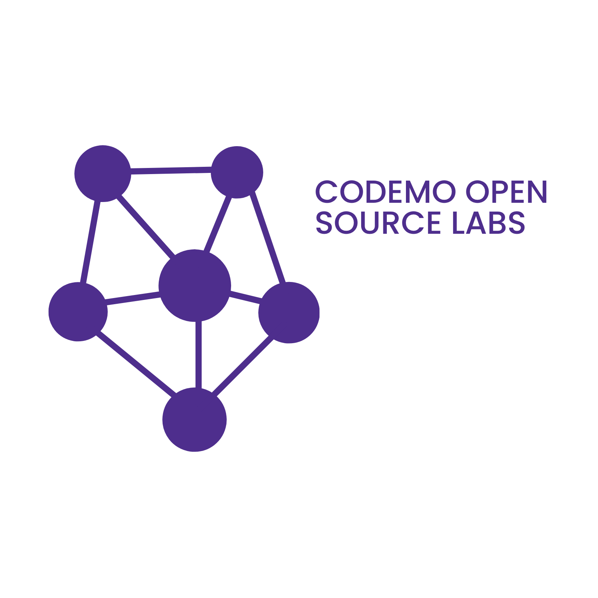
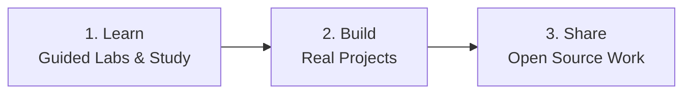
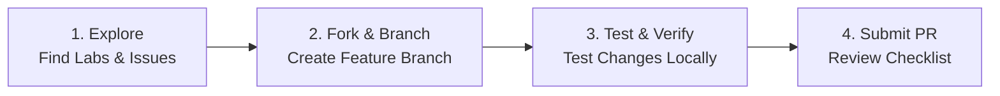
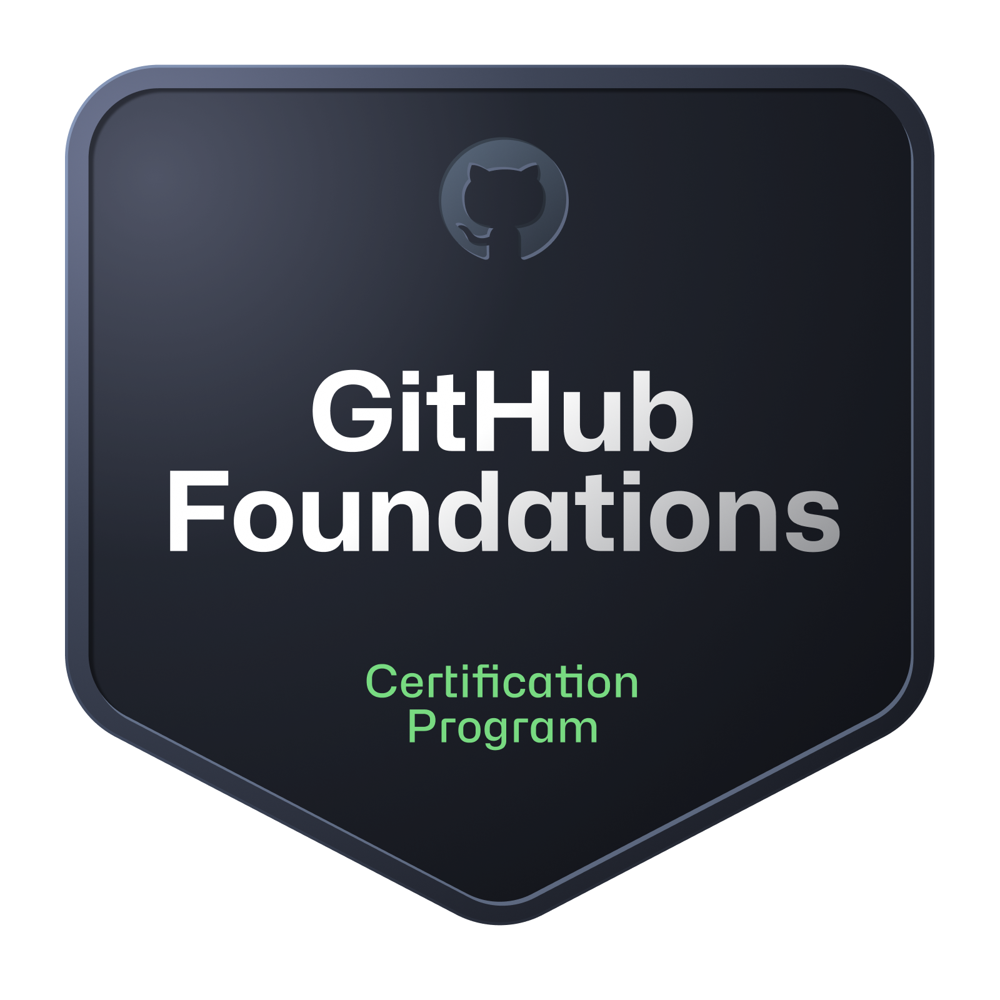
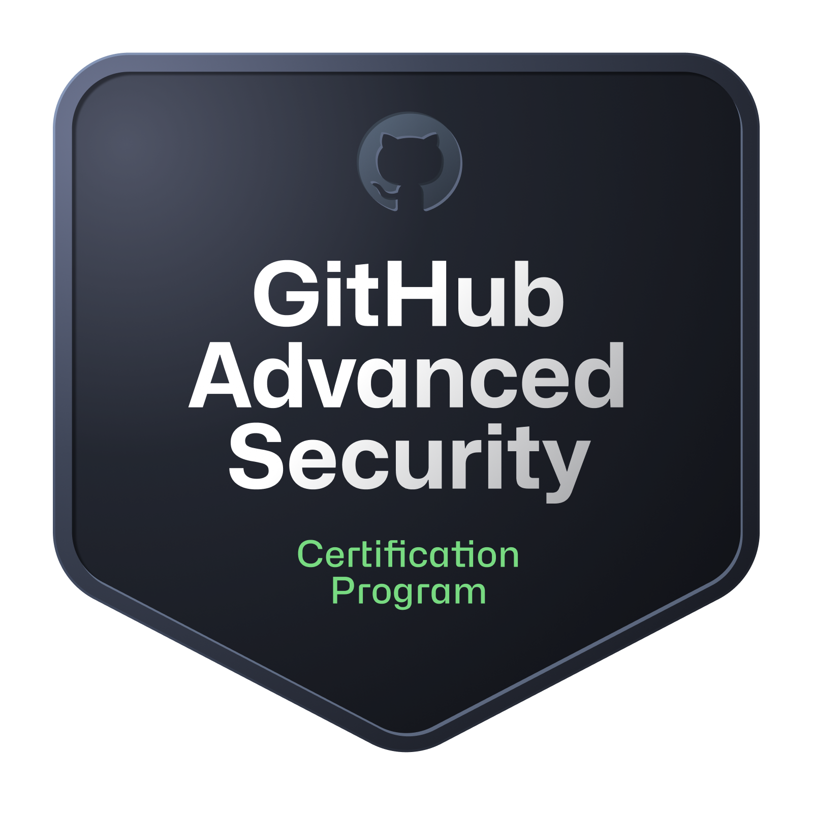
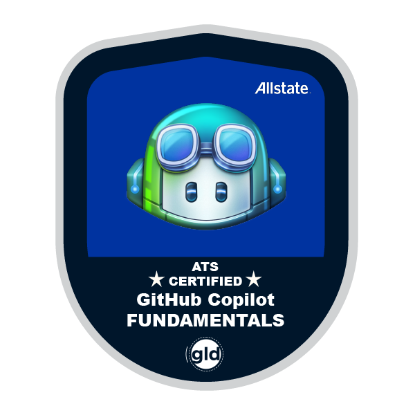
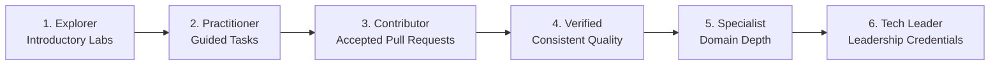

   
  

  
  &nbsp;&nbsp;&nbsp;&nbsp;
  
  &nbsp;&nbsp;&nbsp;&nbsp;
  
  &nbsp;&nbsp;&nbsp;&nbsp;
  

### About COSL

Codemo Open Source Labs (COSL) bridges the gap between learning technology and building with it. We run hands-on environments where developers and students move from reading theory to shipping functional code in the open.

#### Repository Separation: Labs vs Products

All repositories are hosted under the `@codemolabs` organization and are structured into two distinct tracks:
- **Educational Labs:** Hands-on exercises, guided sandboxes, security experiments, and contributor pathways designed for low-friction practice and learning by doing.
- **Product Repositories:** Production-grade software applications, including client tools like [Brave-Music](https://github.com/codemolabs/Brave-Music), built for end users with rigorous testing, architecture reviews, and stable release cycles.

### Technical Focus Areas

<table>
  <tr>
    <td width="50%" valign="top">
      &nbsp; <strong>Open Source Technology Enhancement</strong> 
      Auditing, optimizing, and modernizing established open source software. We contribute upstream to make existing community libraries, tools, and platforms faster, safer, and more maintainable.
    </td>
    <td width="50%" valign="top">
      &nbsp; <strong>Practical Open Source Education</strong> 
      Hands-on learning environments where contributors master software engineering by building in the open. We provide structured GitHub exercises, guided labs, and constructive peer code reviews.
    </td>
  </tr>
  <tr>
    <td width="50%" valign="top">
      &nbsp; <strong>Cross-Domain Products & Tooling</strong> 
      Engineering software across diverse technical domains, including client media applications (such as <a href="https://github.com/codemolabs/Brave-Music">Brave-Music</a>), developer utilities, and backend infrastructure.
    </td>
    <td width="50%" valign="top">
      &nbsp; <strong>Defensive Security & Malware Research</strong> 
      Analyzing threat mechanics and malware architectures strictly in air-gapped sandboxes for educational defense under <a href="https://github.com/codemolabs/.github/blob/main/SECURITY.md#4-educational--safe-harbor-principles">Safe Harbor Principles</a> and statutory cyber laws.
    </td>
  </tr>
</table>

### How to Contribute

We welcome contributions of all sizes, including documentation improvements, bug fixes, automated tests, lab concepts, and new features.

#### Contribution Principles

- **Focus:** Keep pull requests targeted to solve one clear objective.
- **AI-Assisted Contributions:** AI tools are welcome. Contributors must review, understand, test, and take complete responsibility for every line submitted.
- **Safety:** We maintain zero tolerance for malicious code, credential scrapers, or unauthorized security exploits.
- **Kindness:** Every question is valid. We prioritize constructive feedback and steady progress over perfection.

See the complete [Contributing Guide](https://github.com/codemolabs/.github/blob/main/CONTRIBUTING.md) for step-by-step instructions and pull request checklists.

### Community & Governance Standards

All projects across the COSL ecosystem follow shared community health standards:

| Document | Focus and Scope | Link |
|:---|:---|:---:|
| &nbsp; **Organization Structure** | Official hierarchy, responsibilities, and authority boundaries | [Open Document](https://github.com/codemolabs/.github/blob/main/ORGANIZATION.md) |
| &nbsp; **Contributing Guide** | Contribution flow, branch naming, and pull request checklist | [Open Document](https://github.com/codemolabs/.github/blob/main/CONTRIBUTING.md) |
| &nbsp; **Code of Conduct** | Expected behavior, inclusive environment pledge, and moderation | [Open Document](https://github.com/codemolabs/.github/blob/main/CODE_OF_CONDUCT.md) |
| &nbsp; **Security Policy** | Vulnerability disclosure instructions and safe harbor terms | [Open Document](https://github.com/codemolabs/.github/blob/main/SECURITY.md) |
| &nbsp; **Support & Help** | Discord channels, issue reporting, and general inquiries | [Open Document](https://github.com/codemolabs/.github/blob/main/SUPPORT.md) |
| &nbsp; **Learning & Credentials** | Official learning paths, leadership certifications, and progression | [Open Document](https://github.com/codemolabs/.github/blob/main/CREDENTIALS.md) |
| &nbsp; **Community Rules** | Extended behavioral guidelines, licensing, and legal notices | [Open Document](https://github.com/codemolabs/.github/blob/main/RULES.md) |

### Learning, Certifications & Achievements

COSL supports continuous learning through practical exercises, structured study, open-source contributions, and independently verifiable professional credentials.

#### Official GitHub Learning Platforms
- [GitHub Skills](https://learn.github.com/skills): Hands-on interactive GitHub exercises.
- [GitHub Credentials](https://learn.github.com/credentials): Official certification catalogue and proctored examinations.
- [GitHub Courses](https://learn.github.com/courses): Structured technical learning modules.
- [Microsoft Learn](https://learn.microsoft.com/training/): Technical education and exam preparation.

#### Leadership Certification Framework

COSL's proposed leadership certification framework requires designated senior leadership and organization-level authority holders to earn GitHub Foundations through the official certification examination. This requirement becomes binding only after formal COSL adoption. Other technical certifications may be recommended based on assigned responsibilities:

| Badge | Certification & Scope | Target Leadership Role | Details |
|:---:|:---|:---|:---:|
|  | **GitHub Foundations** Repository management, Git collaboration, and GitHub platform features. | **Mandatory** for Director, Deputy Director, and Org Administrators | [Learn More](https://learn.github.com/credentials) |
|  | **GitHub Advanced Security** Code scanning, secret scanning, dependency review, and remediation. | Optional specialist certification (Security) | [Learn More](https://learn.github.com/credentials) |
|  | **GitHub Actions** Automated CI/CD pipelines, custom workflow actions, and release management. | Optional specialist certification (DevOps & Release) | [Learn More](https://learn.github.com/credentials) |
|  | **GitHub Administration** Enterprise management, identity and access control, compliance, and governance. | Optional specialist certification (Administration) | [Learn More](https://learn.github.com/credentials) |
|  | **GitHub Copilot** AI-assisted coding, prompt workflows, and responsible development practices. | Optional specialist certification (AI Development) | [Learn More](https://learn.github.com/credentials) |

*Course tutorials, learning paths, and GitHub Skills exercises represent learning achievements. They are distinct from passing an official proctored certification examination.*

#### Contributor Progression Pathway

Learners and ordinary contributors are not required to purchase or pass a professional certification examination. They develop skills through free self-paced study, hands-on labs, and real contributions across our six progression tiers:

*Developer progression represents learning and technical achievement, not automatic appointment to COSL organizational leadership.*

#### Achievement Categories

COSL recognizes four distinct achievement categories:
- **Learning:** Completed exercises, courses, and learning paths.
- **Technical:** Reviewed labs, project deliverables, tests, and technical demonstrations.
- **Open Source:** Accepted contributions, pull request reviews, maintenance, and upstream collaboration.
- **Professional Certification:** Credentials earned through official examinations and verified via an issuer-supported method.

Review the full policy in [`CREDENTIALS.md`](https://github.com/codemolabs/.github/blob/main/CREDENTIALS.md).

  
  &nbsp;&nbsp;&nbsp;&nbsp;
  
  &nbsp;&nbsp;&nbsp;&nbsp;
  
  &nbsp;&nbsp;&nbsp;&nbsp;
  

