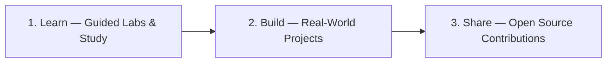
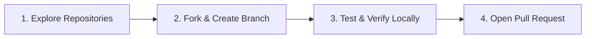
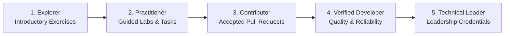

  

<h1 align="center">Open source is learned by doing.</h1>

  <em>Free labs. Real projects. A community to build with.</em>

  
  &nbsp;
  
  &nbsp;
  
  &nbsp;
  

  

---

### About COSL

Open source can often feel intimidating to enter. **Codemo Open Source Labs (COSL)** bridges the gap between learning technology and building with it. We create free, hands-on environments where developers, students, and enthusiasts move from reading theory to shipping real code—collaboratively in the open.

---

### Technical Focus Areas

Our initiatives span real-world software, infrastructure tools, and interactive labs:

<table>
  <tr>
    <td width="50%" valign="top">
      <h4> Systems & Security Automation</h4>
      
Practical security tooling, automated hardening, Linux configurations, and zero-trust engineering labs designed for safe, hands-on learning.

    </td>
    <td width="50%" valign="top">
      <h4> Modern Applications & Media</h4>
      
Performance-focused client and web applications—such as <a href="https://github.com/codemoteams/Brave-Music">Brave-Music</a>—built with clean architecture and responsive user experiences.

    </td>
  </tr>
  <tr>
    <td width="50%" valign="top">
      <h4> Developer Tooling & DevOps</h4>
      
Productivity scripts, CI/CD workflows, and cross-platform utilities that make open-source development faster and more reliable.

    </td>
    <td width="50%" valign="top">
      <h4> Open Educational Labs</h4>
      
Curated, beginner-to-advanced technical challenges that walk learners through git workflows, code reviews, and software testing.

    </td>
  </tr>
</table>

---

### How to Contribute

We welcome contributions of all sizes—documentation improvements, bug fixes, automated tests, lab concepts, and new features.

#### Contribution Principles

- **Focus & Clarity:** Keep pull requests targeted to solve one clear objective.
- **AI-Assisted Contributions:** AI tools are welcome. However, human contributors must review, understand, test, and take complete responsibility for every line submitted.
- **Safety First:** We maintain zero tolerance for malicious code, credential scrapers, or unauthorized security exploits.
- **Kindness & Mentorship:** Every question is valid. We prioritize constructive feedback and progress over perfection.

See the complete [Contributing Guide](https://github.com/codemolabs/.github/blob/main/CONTRIBUTING.md) for step-by-step instructions and pull request checklists.

---

### Community & Governance Standards

All projects across the COSL ecosystem follow shared community health standards:

| Document | Purpose |
|:---|:---|
|  [**Contributing Guide**](https://github.com/codemolabs/.github/blob/main/CONTRIBUTING.md) | Step-by-step contribution flow, commit standards, and PR checklist |
|  [**Code of Conduct**](https://github.com/codemolabs/.github/blob/main/CODE_OF_CONDUCT.md) | Expected behavior, inclusive environment pledge, and moderation principles |
|  [**Security Policy**](https://github.com/codemolabs/.github/blob/main/SECURITY.md) | Responsible vulnerability reporting instructions and safe harbor terms |
|  [**Support & Help**](https://github.com/codemolabs/.github/blob/main/SUPPORT.md) | How to ask questions, join Discord channels, and connect with maintainers |
|  [**Learning & Credentials**](https://github.com/codemolabs/.github/blob/main/CREDENTIALS.md) | Official learning paths, leadership certifications, and progression tiers |
|  [**Community Rules & Legal Notes**](https://github.com/codemolabs/.github/blob/main/RULES.md) | Extended behavioral guidelines, licensing, trademark, and usage notices |

---

### Learning, Certifications & Achievements

COSL supports continuous learning through practical exercises, structured study, open-source contributions, and independently verifiable professional credentials.

#### Official GitHub Learning Platforms
- [GitHub Skills](https://learn.github.com/skills) — Hands-on GitHub exercises.
- [GitHub Credentials](https://learn.github.com/credentials) — Official certifications and credentials catalogue.
- [GitHub Courses](https://learn.github.com/courses) — Structured technical learning.
- [Microsoft Learn](https://learn.microsoft.com/training/) — Technical education and examination preparation.

#### Leadership Certification Framework

Designated COSL executive leadership and organization-level authority holders must earn **GitHub Foundations** by passing the official certification examination. Senior technical leads should pursue relevant role-specific GitHub certifications where available and applicable:

| Certification Badge | Examination & Credentials | Target Leadership Area |
|:---:|:---|:---|
|  | [**GitHub Foundations**](https://learn.github.com/credentials) Repository management, Git collaboration, project management, and features. | **Mandatory** for COSL Directors, Org Owners, and Organization Administrators |
|  | [**GitHub Advanced Security**](https://learn.github.com/credentials) Code scanning, secret scanning, dependency review, and vulnerability remediation. | Security Lead |
|  | [**GitHub Actions**](https://learn.github.com/credentials) Automated CI/CD pipelines, custom action authoring, and release engineering. | DevOps & Release Lead |
|  | [**GitHub Administration**](https://learn.github.com/credentials) Enterprise management, identity/access control, compliance, and governance. | GitHub Administration Lead |
|  | [**GitHub Copilot**](https://learn.github.com/credentials) AI-assisted coding, prompt engineering, developer workflows, and responsible AI. | AI Development Lead |

*Note: Course tutorials, learning paths, and GitHub Skills exercises represent learning achievements. They are distinct from passing an official proctored certification examination.*

#### Contributor Progression Pathway

Learners and ordinary contributors are **not** required to purchase or pass a professional certification examination. They develop skills through free self-paced study, hands-on labs, and real contributions across our progression tiers:

#### Achievement Categories

COSL recognizes four distinct achievement categories:
- **Learning:** Completed exercises, courses, and learning paths.
- **Technical:** Reviewed labs, project deliverables, tests, and technical demonstrations.
- **Open Source:** Accepted contributions, pull request reviews, maintenance, and upstream collaboration.
- **Professional Certification:** Credentials earned through official examinations and verified via an issuer-supported method.

Review the full policy in [`CREDENTIALS.md`](https://github.com/codemolabs/.github/blob/main/CREDENTIALS.md).

---

### Connect With COSL

  <a href="https://discord.gg/wD9d5Er7a"><strong>Discord Server</strong></a> &nbsp;&bull;&nbsp;
  <a href="https://github.com/orgs/codemoteams/repositories"><strong>Explore Repositories</strong></a> &nbsp;&bull;&nbsp;
  <a href="https://cosl.codemoteams.org"><strong>COSL Website</strong></a> &nbsp;&bull;&nbsp;
  <a href="https://codemoteams.org"><strong>Codemo Teams</strong></a> &nbsp;&bull;&nbsp;
  <a href="mailto:cosl@codemoteams.org"><strong>Email Maintainers</strong></a>

  Curiosity starts it. Practice builds it. Open source grows when we share it.

