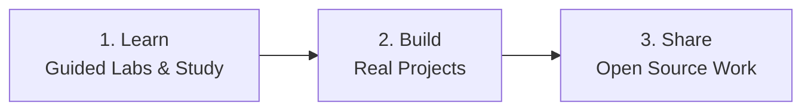
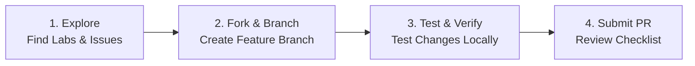
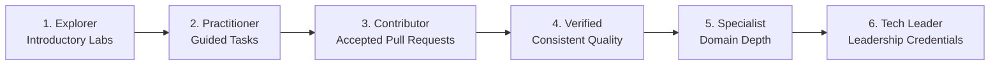

  

<h1 align="center">Open source is learned by doing.</h1>

  

  
  &nbsp;&nbsp;&nbsp;&nbsp;
  
  &nbsp;&nbsp;&nbsp;&nbsp;
  
  &nbsp;&nbsp;&nbsp;&nbsp;
  

---

### About COSL

Codemo Open Source Labs (COSL) bridges the gap between learning technology and building with it. We run hands-on environments where developers and students move from reading theory to shipping functional code in the open.

---

### Technical Focus Areas

<table>
  <tr>
    <td width="50%" valign="top">
      
      <strong><a href="https://github.com/orgs/codemolabs/repositories">Systems and Security Automation</a></strong>
      
Practical security tools, automated system hardening, and zero-trust engineering labs for hands-on learning.

    </td>
    <td width="50%" valign="top">
      
      <strong><a href="https://github.com/codemoteams/Brave-Music">Modern Applications and Media</a></strong>
      
Client and web applications, including the Brave-Music player, focused on clean architecture and performance.

    </td>
  </tr>
  <tr>
    <td width="50%" valign="top">
      
      <strong><a href="https://github.com/orgs/codemolabs/repositories">Developer Tooling and DevOps</a></strong>
      
Productivity scripts, automation utilities, and cross-platform workflows that simplify open source maintenance.

    </td>
    <td width="50%" valign="top">
      
      <strong><a href="https://github.com/orgs/codemolabs/repositories">Open Educational Labs</a></strong>
      
Curated technical exercises that guide contributors through Git workflows, automated testing, and code reviews.

    </td>
  </tr>
</table>

---

### How to Contribute

We welcome contributions of all sizes, including documentation improvements, bug fixes, automated tests, lab concepts, and new features.

#### Contribution Principles

- **Focus:** Keep pull requests targeted to solve one clear objective.
- **AI-Assisted Contributions:** AI tools are welcome. Contributors must review, understand, test, and take complete responsibility for every line submitted.
- **Safety:** We maintain zero tolerance for malicious code, credential scrapers, or unauthorized security exploits.
- **Kindness:** Every question is valid. We prioritize constructive feedback and steady progress over perfection.

See the complete [Contributing Guide](https://github.com/codemolabs/.github/blob/main/CONTRIBUTING.md) for step-by-step instructions and pull request checklists.

---

### Community & Governance Standards

All projects across the COSL ecosystem follow shared community health standards:

| Document | Focus and Scope | Link |
|:---|:---|:---:|
|  [**Organization Structure**](https://github.com/codemolabs/.github/blob/main/ORGANIZATION.md) | Official hierarchy, responsibilities, and authority boundaries | [Open Document](https://github.com/codemolabs/.github/blob/main/ORGANIZATION.md) |
|  [**Contributing Guide**](https://github.com/codemolabs/.github/blob/main/CONTRIBUTING.md) | Contribution flow, branch naming, and pull request checklist | [Open Document](https://github.com/codemolabs/.github/blob/main/CONTRIBUTING.md) |
|  [**Code of Conduct**](https://github.com/codemolabs/.github/blob/main/CODE_OF_CONDUCT.md) | Expected behavior, inclusive environment pledge, and moderation | [Open Document](https://github.com/codemolabs/.github/blob/main/CODE_OF_CONDUCT.md) |
|  [**Security Policy**](https://github.com/codemolabs/.github/blob/main/SECURITY.md) | Vulnerability disclosure instructions and safe harbor terms | [Open Document](https://github.com/codemolabs/.github/blob/main/SECURITY.md) |
|  [**Support & Help**](https://github.com/codemolabs/.github/blob/main/SUPPORT.md) | Discord channels, issue reporting, and general inquiries | [Open Document](https://github.com/codemolabs/.github/blob/main/SUPPORT.md) |
|  [**Learning & Credentials**](https://github.com/codemolabs/.github/blob/main/CREDENTIALS.md) | Official learning paths, leadership certifications, and progression | [Open Document](https://github.com/codemolabs/.github/blob/main/CREDENTIALS.md) |
|  [**Community Rules**](https://github.com/codemolabs/.github/blob/main/RULES.md) | Extended behavioral guidelines, licensing, and legal notices | [Open Document](https://github.com/codemolabs/.github/blob/main/RULES.md) |

---

### Learning, Certifications & Achievements

COSL supports continuous learning through practical exercises, structured study, open-source contributions, and independently verifiable professional credentials.

#### Official GitHub Learning Platforms
- [GitHub Skills](https://learn.github.com/skills): Hands-on interactive GitHub exercises.
- [GitHub Credentials](https://learn.github.com/credentials): Official certification catalogue and proctored examinations.
- [GitHub Courses](https://learn.github.com/courses): Structured technical learning modules.
- [Microsoft Learn](https://learn.microsoft.com/training/): Technical education and exam preparation.

#### Leadership Certification Framework

COSL's proposed leadership certification framework requires designated senior leadership and organization-level authority holders to earn GitHub Foundations through the official certification examination. This requirement becomes binding only after formal COSL adoption. Other technical certifications may be recommended based on assigned responsibilities:

| Badge | Certification & Scope | Target Leadership Role | Details |
|:---:|:---|:---|:---:|
|  | [**GitHub Foundations**](https://learn.github.com/credentials) Repository management, Git collaboration, and GitHub platform features. | **Mandatory** for Director, Deputy Director, and Org Administrators | [Learn More](https://learn.github.com/credentials) |
|  | [**GitHub Advanced Security**](https://learn.github.com/credentials) Code scanning, secret scanning, dependency review, and remediation. | Optional specialist certification (Security) | [Learn More](https://learn.github.com/credentials) |
|  | [**GitHub Actions**](https://learn.github.com/credentials) Automated CI/CD pipelines, custom workflow actions, and release management. | Optional specialist certification (DevOps & Release) | [Learn More](https://learn.github.com/credentials) |
|  | [**GitHub Administration**](https://learn.github.com/credentials) Enterprise management, identity and access control, compliance, and governance. | Optional specialist certification (Administration) | [Learn More](https://learn.github.com/credentials) |
|  | [**GitHub Copilot**](https://learn.github.com/credentials) AI-assisted coding, prompt workflows, and responsible development practices. | Optional specialist certification (AI Development) | [Learn More](https://learn.github.com/credentials) |

*Course tutorials, learning paths, and GitHub Skills exercises represent learning achievements. They are distinct from passing an official proctored certification examination.*

#### Contributor Progression Pathway

Learners and ordinary contributors are not required to purchase or pass a professional certification examination. They develop skills through free self-paced study, hands-on labs, and real contributions across our six progression tiers:

*Developer progression represents learning and technical achievement, not automatic appointment to COSL organizational leadership.*

#### Achievement Categories

COSL recognizes four distinct achievement categories:
- **Learning:** Completed exercises, courses, and learning paths.
- **Technical:** Reviewed labs, project deliverables, tests, and technical demonstrations.
- **Open Source:** Accepted contributions, pull request reviews, maintenance, and upstream collaboration.
- **Professional Certification:** Credentials earned through official examinations and verified via an issuer-supported method.

Review the full policy in [`CREDENTIALS.md`](https://github.com/codemolabs/.github/blob/main/CREDENTIALS.md).

---

  
  &nbsp;&nbsp;&nbsp;&nbsp;
  
  &nbsp;&nbsp;&nbsp;&nbsp;
  
  &nbsp;&nbsp;&nbsp;&nbsp;
  

